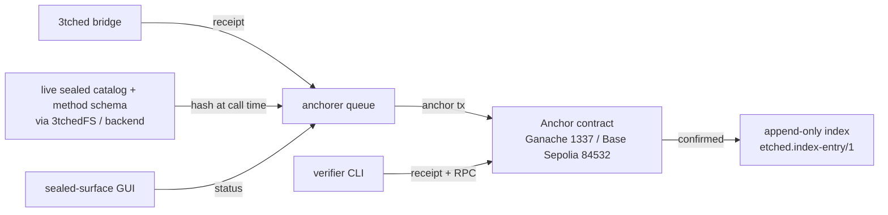

# Design Document — receipt-anchoring

## Overview

Three parts in `web3/`: an anchor contract, an anchorer service, and a
verifier CLI. Inputs come from the running 3tched backend (receipts, the live
sealed catalog, per-method sealed schemas). Nothing is copied into this repo.
(Req 1, 2)

## Architecture

## Components and Interfaces

- `web3/contracts/` — anchor contract. Records
  `(receiptHash, catalogHash, schemaHash)` once per `receiptHash`; emits an
  event; rejects duplicates. (Req 2.3, 6.2) Relationship to the earlier
  EtchedAnchor proof: this is new code written in Kiro; the earlier contract
  is disclosed in PREEXISTING.md. Assumption: compatibility with the earlier
  event shape is desirable but not required.
- `web3/anchorer/` — subscribes to receipts from the backend, captures the
  catalog and schema hashes at call time, submits transactions, tracks status
  `queued | submitted | confirmed | failed`, writes index entries. (Req 1, 2.4, 3, 6)
- `web3/verify/` — CLI: given a receipt and RPC URL, recomputes the receipt
  hash and checks the on-chain record and timestamp. (Req 4)
- Config: `ANCHOR_RPC_URL`, `ANCHOR_CHAIN_ID` (env); signing key from
  `/etc/op-dbus/secrets` on antix1. (Req 5)

## Data Models

- Receipts, catalog and schemas: the backend's live formats.
- Index entries: the platform's live `etched.index-entry/1` format, read from
  the backend at runtime; `artifact.chain_id` set to 1337 or 84532,
  `artifact.ref` the transaction hash.
- Hashing: sha256 over canonical JSON (assumption, matches the index
  format's `prev_hash` rule; to confirm against the live backend in task 1).

## Error Handling

- Unmatched receipt → dropped with a logged reason, never anchored. (Req 1.2)
- Tx failure → stays queued with reason; retry checks the contract first. (Req 6)
- Unknown chain id → refuse to start. (Req 5.3)

## Security

No new authority. The anchorer only observes backend receipts; the signing
key is never logged or committed. The chain records hashes only — no
arguments, results or personal data.

## Testing Strategy

- Contract tests on a local chain: single record per receipt, event fields.
- Anchorer unit tests: refusal/unknown-outcome not anchored, call-time hash
  capture, idempotent retry, index hash chain.
- Verifier tests: match, and mismatch per field.
- Opt-in end-to-end on Ganache against the live backend.

## Open Questions

- Location of the earlier EtchedAnchor source (not in public repos).
- How the anchorer subscribes to receipts on the live backend (bridge feed vs
  reading the mount's results).
- Canonical JSON rule used by the backend.
