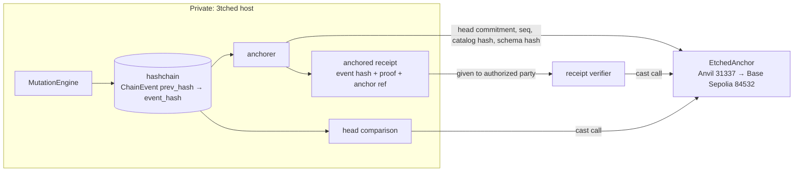

# Design Document — receipt-anchoring

## Overview

EtchedAnchor (new, Foundry) publishes periodic **commitments** to the head
of 3tched's existing private hashchain. The chain is the timestamp, not the
trust; the private chain stays private; receipts are what authorized parties
verify. (Req 1–5)

Pre-existing inputs (see PREEXISTING.md), consumed live from the backend:

- The hashchain: `ChainEvent` records in `crates/op-state-store/src/event_chain.rs`
  — `event_hash = H(prev_hash || canonical_payload)`, Merkle batching,
  committed by the `MutationEngine` (`crates/op-grpc-bridge/src/mutation_engine.rs`,
  which exposes the chain head).
- Its vectorization (`chain_vector_projector.rs`, `op-cognitive`
  `chain_vectors.rs`) is unaffected and never published.

## Architecture

## Components and Interfaces

- `web3/src/EtchedAnchor.sol` — stores, per sequence number:
  `(headCommitment, catalogHash, schemaHash, timestamp)`; `anchor(seq,
  head, catalog, schema)` restricted to the anchoring key, `seq` strictly
  increasing; emits `Anchored`. `bytes32` fields only. (Req 1.3, 1.5, 2.1)
- `web3/script/Deploy.s.sol` — `forge script` deployment to Anvil, then
  Base Sepolia. (Req 6)
- `web3/test/` — `forge test` unit + fuzz tests. (Req 6.4)
- `web3/anchorer/` — reads the current head from the backend on a timer,
  skips if unchanged, submits, tracks `pending | anchored | failed`, and for
  each covered event builds the inclusion proof (hash path through the
  chain/Merkle batch to the anchored head) and issues the anchored receipt to
  authorized parties via the existing backend grants. (Req 1, 3, 7)
- `web3/verify/` — receipt verifier: recomputes the head from the receipt's
  event hash and proof, reads the anchor with `cast call`, compares head,
  catalog hash and schema hash. Needs only the receipt and an RPC URL. (Req 4)
- `web3/compare/` — operator-side: recomputes the local head at each anchored
  seq and compares to EtchedAnchor; reports the first mismatch. Runs on the
  host; publishes nothing. (Req 5)

## Data Models

- Head commitment: the hashchain head hash at sequence N, as `bytes32`.
  **Assumed**: the head hash is already high-entropy, so committing it
  directly leaks nothing; if the backend's head is not 32 bytes, commit
  `sha256(domain || head)` (Open Question 2).
- Anchored receipt (off-chain, private to its holder): event hash, catalog
  hash, schema hash, inclusion proof (list of sibling/prev hashes), anchored
  seq, chain id, contract address, tx hash. Receipt fields otherwise follow
  the backend's live receipt format.

## Error Handling

- Tx failure → `failed` with reason; retried next interval; the contract's
  strictly increasing `seq` makes duplicates impossible. (Req 7)
- Unknown chain id → refuse to start. (Req 6.3)
- Proof does not reach an anchored head → verifier reports tamper evidence
  naming the field. (Req 4.3)

## Security

- No new authority: the anchorer only reads committed heads; receipt delivery
  uses the existing grants.
- On-chain data is hashes and sequence numbers only (Req 2). The private
  chain, its events and vectors are never published.
- Signing key from `/etc/op-dbus/secrets`, never logged or committed.

## Testing Strategy

- `forge test`: only the anchoring key may anchor; `seq` strictly
  increasing; fields stored and event emitted; fuzz over arbitrary hashes and
  sequence orderings.
- Anchorer: skip-when-unchanged, no anchored receipt for refusals/unknown
  outcomes, idempotent retry.
- Verifier: valid receipt verifies; tampered event hash, proof, catalog hash
  or schema hash each yield tamper evidence naming the field.
- Comparison: rewritten or truncated local chain detected at the right seq.
- Opt-in end-to-end on local Anvil against the live backend.

## Open Questions

- How the anchorer reads the current head from the live backend (a sealed
  method, or the bridge's chain feed).
- The exact head hash width and canonical-JSON rule used by `event_chain.rs`.
- Anchoring interval for the demo.
