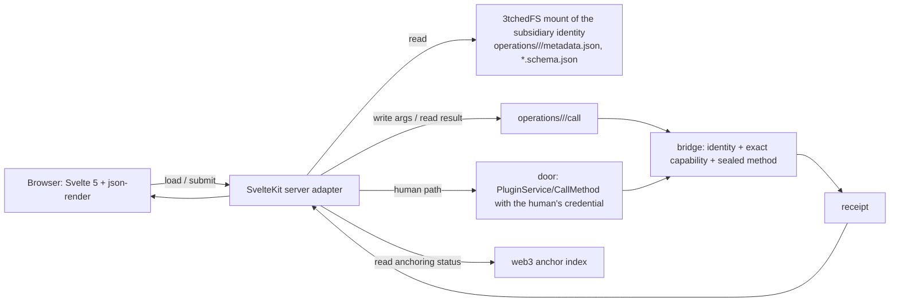

# Design Document — sealed-surface-gui

## Overview

A SvelteKit app (`ui/`) whose screens are derived from the live sealed
schema of the running 3tched backend. A thin server-side adapter is the only
code that talks to the backend; the browser never sees a method it is not
granted. All formats (method metadata, schemas, grants, receipts) are the
backend's own, read at runtime. (Req 1, 2)

## Architecture

## Components and Interfaces

- `ui/src/lib/server/backend.ts` — the backend adapter. Reads the live
  catalog and per-method files from the identity's mount (path from env, e.g.
  the container's `3tchedfs` mount); writes `call`; reads result/`error`.
  Alternative transport: the door's generic call method. No other calls. (Req 1, 3.2, 3.4)
- `ui/src/lib/server/grants.ts` — reads the identity's grants from the
  backend and filters methods by exact capability match before anything is
  sent to the browser. (Req 2)
- `ui/src/lib/schema-form/` — renders a form from a live
  `input.schema.json` and validates with a JSON Schema validator before
  submit. (Req 3.1, 3.3)
- `ui/src/lib/governance/` — hand-written governance components only:
  `Receipt`, `Refusal`, `OutcomeUnknown`, `RejectedSpec`, `AnchorStatus`. (Req 4, 5.2)
- `ui/src/lib/render/` — json-render integration; validates generated specs
  against the live `json_render` catalog. (Req 5)
- `ui/src/routes/loop/` — the four loop steps. (Req 6)

## Data Models

None defined here. Types are generated or inferred at runtime from the live
backend: method metadata (`name`, `args`, `returns`, `side_effect`,
`idempotent`, `required_capability`, `subid`), receipts as returned by the
backend, grants as exact capability strings. Assumption (to verify in task
1): the identity mount exposes grants in a readable form; if not, grants come
from the door.

## Error Handling

- Backend unreachable / schema unreadable → unavailable state, no action
  controls. (Req 1.3)
- Validation failure → inline errors, no dispatch. (Req 3.3)
- Refusal → `Refusal` with missing capability. (Req 4.2)
- Outcome unknown → `OutcomeUnknown` with operation id, no retry. (Req 4.3)

## Security

The GUI adds no authority. Filtering by grants is a display concern; the
bridge remains the enforcement point (`admit(a) ⇔ identity ∧ grants ∧
sealed`). The browser never holds the identity's credential.

## Testing Strategy

- Unit: grants filter (exact match), schema-form validation, spec-vs-catalog
  validation, governance components.
- Contract tests with recorded backend responses captured from the live mount
  at test time (not committed as schema copies).
- Opt-in integration test against the live backend on antix1.

## Open Questions

- Exact sealed methods for "spawn subsidiary" and "issue grant" on the live
  backend (names come from the sealed catalog).
- Whether the GUI runs inside the subsidiary container (identity path) or on
  the host behind the door (human path) for the demo.
